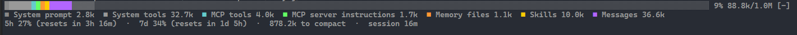

# akash-mods

A couple of mods I made for [Claude Code](https://claude.com/claude-code). I'm a uni student and I use Claude Code a lot
for assignments and side projects, and two things kept annoying me: I never knew how full the context window was
until it auto-compacted, and when it did compact I'd lose track of where I was. So I built these to fix that for
myself. They're small, but they've made my sessions a lot less messy, so I figured I'd share them.

| Mod | What it does | Status |
| --- | --- | --- |
| [context-bar](plugins/context-bar) | Always-on bar showing how full the context window is, plus your rate limits | Published in Claude's plugin directory |
| [auto-handoff](plugins/auto-handoff) | Hands a long session off cleanly before it compacts (was context-handoff) | In review for the directory |
| [pinned-notes](plugins/pinned-notes) | Pins notes to a session so they stay on screen and Claude keeps to them (was session-pins) | In review for the directory |
| [voice-profile](plugins/voice-profile) | Learns how you write once, then drafts messages that sound like you | New, not submitted yet |
| [assessment-marker](plugins/assessment-marker) | Marks your uni assessments against the real rubric, with HD as the bar | New, not submitted yet |
| [session-archive](plugins/session-archive) | Keeps a copy of every session before the 30-day cleanup, with titles, search and a stats pane | New, not submitted yet |
| [coach](plugins/coach) | Notes for Claude when it loops on the same error, says "done" without checking, or slips into habits you've banned | New, not submitted yet |
| [tool-guards](plugins/tool-guards) | No shell file edits (so /rewind works), no attribution in your commits, asks before huge reads | New, not submitted yet |
| [needs-you](plugins/needs-you) | Slack DM when Claude has been waiting on you; reply there to carry on | New, not submitted yet |
| [application-assistant](plugins/application-assistant) | Job and internship applications: role scan, eligibility checks, packs, form filling, tracker, reminders | New, not submitted yet |

## Install

```
/plugin marketplace add Akash001uts/claude-mods
/plugin install context-bar@akash-mods
/plugin install auto-handoff@akash-mods
/plugin install pinned-notes@akash-mods
/plugin install voice-profile@akash-mods
/plugin install assessment-marker@akash-mods
/plugin install session-archive@akash-mods
/plugin install coach@akash-mods
/plugin install tool-guards@akash-mods
/plugin install needs-you@akash-mods
/plugin install application-assistant@akash-mods
```

You can install just the ones you want. You need a recent Claude Code build that supports mods
(function-hook plugins). I built these on 2.1.288.

To get new versions, run `/plugin marketplace update akash-mods`.

## context-bar

A bar above (or below) the prompt that shows how full your context window is, split into the same categories `/context` uses
(system prompt, tools, memory files, messages and so on).



**Why it's useful:** I used to run `/context` every so often just to check. Now it's always there, so I can see when a
session is getting heavy and decide to wrap up before things get compacted. The third line shows your 5-hour and 7-day
rate limits, which is handy if you're on a subscription and don't want to hit the limit halfway through an assignment.
It's also good for finding what's eating your context, like MCP servers you forgot were still connected.

How it works:

- It turns on at the start of every session and updates after each turn.
- The first time it runs it prints a quick rundown of the commands in the chat, and `/context-bar help` shows it again.
- The third line shows your rate limits (subscription accounts only), how many tokens are left before auto-compact
  kicks in, and how long the session has been running. It hides itself if there isn't room for it.
- If you're on pace to use up your 7-day limit before it resets, the third line says how long you have left, like
  `7d 80% (out in 1d 0h at this pace, resets in 3d 0h)`.
- `/context-bar` hides or shows the bar for the current session.
- `/context-bar below` moves the bar under the prompt box if you'd rather have it there, and `/context-bar above` moves
  it back. It remembers your choice ("Bar position" in `/config` sets where it starts).
- `/context-bar details` opens a pane with the full breakdown: each category and its share of the window, every memory
  file, MCP servers (and how many of their tools are loaded), your biggest skills, custom agents, and the cache split
  of the last API call, plus what your last turn used (tokens, rough cost at API prices, how far your limits moved).
  Counting all that costs a few extra requests (same as `/context`), so it only refreshes while
  the pane is open, after each turn or when you press `r`.

## auto-handoff

This used to be called context-handoff. If you installed it under that name, uninstall `context-handoff@akash-mods` and
install `auto-handoff@akash-mods`.

Once a session gets long, Claude tends to get worse at keeping track of things, and auto-compact doesn't always keep
the parts you actually need. This mod hands the work off properly instead. When the context window hits a threshold
(50% by default):

1. Claude gets asked to wrap up. It updates the docs your project already has, writes a handoff file
   (`.claude/handoff.md`), and drafts compaction instructions plus a kickoff prompt.
2. The mod runs `/compact` with those instructions, so the summary keeps what matters.
3. Once compaction finishes, it sends the kickoff prompt and Claude picks up from the handoff file.

**Why it's useful:** it's for longer pieces of work that don't fit in one context window, like a full assignment, a
project that's spread over a few days, or a big refactor. Without it you end up writing "here's where we're up to" notes by
hand before every compact. This does that for you, and the project docs stay up to date as a side effect. The
handoff file also means I can close the terminal, come back the next day and carry on without explaining everything
again.

It also lets Claude see how full the context is. Each prompt gets a hidden line like
`Context window: 34% used (68.0k of 200.0k)`, and Claude's told to suggest wrapping up (once, and only when a task is
actually finished) if the window is filling up. If you run `/auto-handoff:wrap-up` yourself at the end of a session,
the kickoff prompt will be waiting in the prompt box next time you open a session in that project.

Commands and settings:

- It's on from the start of every session, like the bar. The status line shows `Handoff at 50%` so you know it's armed,
  and it changes to show what step it's on while a handoff is running.
- `/handoff` starts a handoff straight away, whatever the context level.
- `/handoff 60` (or `/handoff at 60%`) changes when the automatic handoff starts. Anything from 5% to 95% works, and it
  saves in the plugin's own storage so it sticks between sessions.
- `/handoff off` and `/handoff on` pause or resume the automatic handoff for the current session.
- `/handoff status` shows the current reading and settings, and `/handoff resume` puts a saved kickoff prompt back in
  the box.
- In `/config` you can also change `mode`: `auto` (the default) does everything itself, `ask` puts the handoff prompt in
  the box for you to send, and `off` just shows Claude the reading. `handoffPath` changes where the handoff file goes.
- It only hands off from the main conversation, and only after a turn finishes normally. If you interrupt a turn it
  cancels, and Claude Code's own auto-compact never triggers the kickoff prompt.

## pinned-notes

Pins a note to the session. `/pin Use Australian spelling` puts it above the prompt with a 📌, and Claude gets it in
its system prompt as a standing instruction for the rest of the session.

**Why it's useful:** there's usually one or two things I want Claude to keep in mind the whole time ("don't touch the
tests folder", which branch I'm on, how I want things worded). Said once in chat, they scroll away and can get lost
when the session compacts. Pinned, they stay on screen for me and in the system prompt for Claude, so they survive a
compact.

- `/pin <text>` pins a note, and `/pin` on its own pins the last message you typed.
- `/pin <path>` pins a file or folder as a link, and Claude gets the full path so it can read it when it's relevant.
- `/pin rules` pins your CLAUDE.md files as rules, so Claude treats them as binding and re-reads them after a compact.
- `/pin list` shows them all, `/unpin 2` removes one, `/unpin` removes the latest and `/unpin all` clears them.
- `/pin hide` and `/pin show` hide or show them above the prompt (Claude still sees them).
- Pins come back if you resume the session, and a new session (or `/clear`) asks whether to keep your last session's pins.

## voice-profile

Learns how you write and then drafts messages in your voice. The first time you open Claude Code after installing it,
you tick which sources it can learn from (Gmail, Slack, LinkedIn posts, assignments and reports) and skip the rest.
After that you just ask normally, like "reply to this recruiter" or "make it less formal", and it picks the right
voice and how formal to be.

**Why it's useful:** I was spending two or three rounds on every email or post getting the tone right. Now the first
draft is already close, and when I correct something ("remember I never say X") it sticks.

- It keeps a profile at `~/.claude/voice-profile/profile.md` that you can open and edit.
- `/write` shows the profile and `/write setup` adds more sources later.
- It only reads the sources you tick, through your own connectors, and keeps a short description plus a few short
  excerpts, not your messages.

## assessment-marker

Marks my uni assessments before I submit them, strictly against the real rubric, with High Distinction as the bar
every time. You set each subject up once (it walks you through adding course content, notes, past assignments and
feedback), then just ask "grade it now", "check it again" or "am I ready to submit?".

**Why it's useful:** I was pasting the same long marking prompt into every chat and re-explaining the rubric. Now the
first review already reads the rubric properly, runs and checks everything, and tells me the smallest fixes that
move a band. When marks come back it learns what that marker cares about.

- It never edits your work while marking, and every subject is kept separate.
- `/mark` is optional (`/mark ready`, `/mark setup`); plain requests work.
- Everything it keeps goes in each subject's own folder, under `.assessment-marker/`.

## session-archive

Claude Code deletes your transcripts after 30 days and names sessions after whatever you typed first. This keeps a copy
of every session in a folder you pick (a OneDrive or Dropbox folder doubles as a backup), gives each one a short title
(also in `/resume` and the desktop sidebar), and lets you search all of them with `/sessions search`.

**Why it's useful:** I lost sessions I wanted back. Now "the session where I sped up the order book" finds it, and
`/sessions stats` shows a heatmap, streaks, tokens per model and a rough cost per day, month and project, in the
terminal and the desktop app, without losing old days.

- One copy per session: each copy overwrites the last, so the archive never fills up with snapshots.
- Search by meaning uses a small Haiku call over titles and summaries; `--plain` is free.
- `/sessions off` stops it for one project.

## coach

Watches Claude's turns and adds a short note when it goes wrong: going round in circles on the same error, saying
something works when nothing has run since the files changed, or using phrases and comment styles you've banned.

**Why it's useful:** the "you're absolutely right, fixed!" loop. Coach catches the second identical error and tells
Claude to stop and rethink, and asks it to run the tests before it says done.

- It never blocks anything; you pick which parts are on and whether you see the notes too.
- `/coach ban "<phrase>"`, `/coach comments 2`, `/coach language english` set your own rules.

## tool-guards

Checks Claude's tool calls before they run: no editing files through the shell (so `/rewind` can undo everything), no
Co-Authored-By or "Generated with Claude Code" lines in your commits and PRs, and a permission prompt before a read
that would take a quarter of the context you have left.

**Why it's useful:** my repos are published under my name, and I kept having to strip attribution out by hand.

- `/guards` turns each guard on or off; shell edits can be limited to auto mode.

## needs-you

When Claude has been waiting on you for 5 minutes (finished, asking permission, or asking a question), it DMs you on
Slack through the claude.ai Slack connector. Reply in Slack and the session carries on from there.

**Why it's useful:** no more coming back to a session that sat on a permission prompt for an hour.

- Only your own Slack user's replies count. Without Slack, it falls back to Claude Code's push notification.
- It also notices commands you approve every time and suggests an allow rule.

## application-assistant

Does the daily job-application loop with you: finds roles, checks them against your work rights and dates, builds a
pack (resume picked or tailored, cover letter, form answers), fills the form in Chrome for you to submit, and keeps
your tracker and reminders up to date from your inbox.

**Why it's useful:** I was doing all of this by hand for internships. Your profile is built from your own answers at
setup and stays on your machine.

- It never submits anything and only claims what your base resume already says.

## What they run and store

None of them send anything outside Claude Code (voice-profile reads Gmail, Slack or LinkedIn only if you tick them, through your own connectors). context-bar only reads the same usage numbers `/context` shows,
auto-handoff adds one hidden line to each prompt and runs `/compact` during a handoff, pinned-notes adds your pins to
the system prompt and saves them in plugin storage, voice-profile adds your profile to the system prompt, and assessment-marker adds a short note about the subject you're in and keeps its reviews in that subject's folder. session-archive copies transcripts into the folder you choose and sends titles and summaries through small Haiku calls, coach adds notes for Claude and makes one small yes/no call for its done-check, tool-guards refuses or rewrites some commands, needs-you sends pings to your own Slack DM through the claude.ai connector, and application-assistant reads your inbox and resumes only through its skills, when you ask. Each plugin's own README has
the full list: [context-bar](plugins/context-bar/README.md#what-it-runs-and-stores),
[auto-handoff](plugins/auto-handoff/README.md#what-it-runs-and-stores),
[pinned-notes](plugins/pinned-notes/README.md#what-it-runs-and-stores),
[voice-profile](plugins/voice-profile/README.md#what-it-runs-and-stores),
[assessment-marker](plugins/assessment-marker/README.md#what-it-runs-and-stores),
[session-archive](plugins/session-archive/README.md#what-it-runs-and-stores),
[coach](plugins/coach/README.md#what-it-runs-and-stores),
[tool-guards](plugins/tool-guards/README.md#what-it-runs-and-stores),
[needs-you](plugins/needs-you/README.md#what-it-runs-and-stores),
[application-assistant](plugins/application-assistant/README.md#what-it-runs-and-stores).

## Notes

These are still pretty new, so there are probably rough edges. If something breaks or you've got an idea, feel free to
[open an issue](https://github.com/Akash001uts/claude-mods/issues).

This is a personal project and isn't affiliated with or endorsed by Anthropic.

## Licence

MIT
